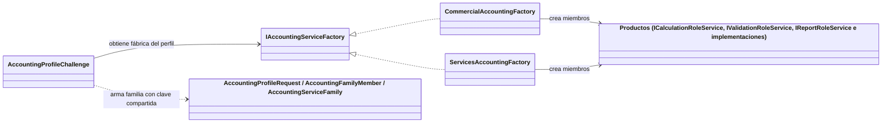

## Explicación del problema

Generar una familia coherente de miembros/servicios contables (cálculo,
validación, reporte) según el perfil (comercial, servicios) y régimen
ficticio, compartiendo una clave de compatibilidad única y rechazando
perfiles inválidos o vacíos.

Mezclar perfiles o instanciar servicios por separado rompería la
compatibilidad entre miembros de la familia y acoplaría la creación a
cada combinación.

## Elección del patrón

**Abstract Factory** permite crear familias de objetos relacionados y
compatibles (cálculo, validación, reporte) para un mismo perfil sin
acoplar al llamador a las clases concretas de cada variante.

Encaja mejor que **Factory Method** (un solo producto variable) o
**Builder** (construcción paso a paso) porque se ensambla un conjunto
coordinado de roles por perfil.

## Participantes de mi solución

-   **AccountingProfileChallenge (`CreateFamily`):** Valida la
    solicitud, obtiene la fábrica del perfil y arma la familia con la
    clave de compatibilidad compartida.
-   **IAccountingServiceFactory:** Declara la creación de los servicios
    de cálculo, validación y reporte para una familia.
-   **CommercialAccountingFactory / ServicesAccountingFactory:**
    Fábricas concretas que producen los miembros correspondientes a cada
    perfil.
-   **Productos (`ICalculationRoleService`, `IValidationRoleService`,
    `IReportRoleService` y sus implementaciones):** Generan cada
    `AccountingFamilyMember` con su rol y clave de compatibilidad.
-   **AccountingProfileRequest / AccountingFamilyMember /
    AccountingServiceFamily:** Records inmutables de entrada, miembro de
    familia y familia resultante.

## UML de mi solución

## Evidencia de pruebas

3/3 aprobados en este desafío; [ALL-results.trx](Evidencia/ALL-results.trx) — 66/66 en la suite completa.

Línea base conservada: [results.trx](../../reports/delivery/PatternChallenges/results.trx) — 0/66.

## Ventajas, límites y coste

- Ventaja: la familia comparte una clave de compatibilidad y el llamador no conoce las fábricas concretas.
- Límite: un perfil nuevo exige una fábrica concreta nueva.
- Coste: agregar un rol obliga a tocar la interfaz de fábrica y todas las implementaciones.
