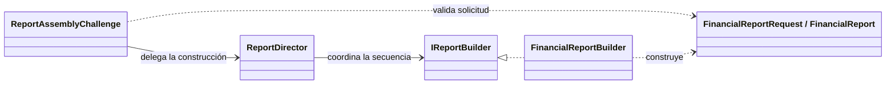

## Explicación del problema

Ensamblar un `FinancialReport` a partir de `FinancialReportRequest` (título, rango de fechas `From/To`, listas de `Sections` y `Annexes`), validando entradas obligatorias/coherentes y manteniendo listas seguras.

Armar el reporte directamente en una llamada suelta o con constructores sobrecargados vuelve el ensamblaje rígido, propenso a errores de orden/validación o duplicación al agregar partes.

## Elección del patrón

**Builder** separa la construcción paso a paso de un objeto (`Title`, periodo, `Sections`, `Annexes`) de su representación final (`FinancialReport`), permitiendo un flujo ordenado y extensible.

Encaja mejor que **Factory Method** (un solo producto variable por tipo) o **Abstract Factory** (familias de productos) porque se compone un único reporte a partir de múltiples partes y pasos.

## Participantes de mi solución

- **ReportAssemblyChallenge (Build)**  
  Valida la solicitud (`request`, título y rango de fechas), configura el builder y delega la construcción al director.

- **IReportBuilder**  
  Define las operaciones paso a paso para asignar título, periodo, secciones y anexos, y obtener el `FinancialReport`.

- **FinancialReportBuilder**  
  Acumula y limpia las partes del reporte (`Title`, `From`, `To`, `Sections`, `Annexes`) y construye la instancia final.

- **ReportDirector**  
  Coordina la secuencia de construcción sobre el `IReportBuilder` recibido.

- **FinancialReportRequest / FinancialReport**  
  Records inmutables que representan la petición de entrada y el reporte financiero armado.

## UML de mi solución

## Evidencia de pruebas

3/3 aprobados en este desafío; [ALL-results.trx](Evidencia/ALL-results.trx) — 66/66 en la suite completa.

Línea base conservada: [results.trx](../../reports/delivery/PatternChallenges/results.trx) — 0/66.

## Ventajas, límites y coste

- Ventaja: el ensamblaje de título, periodo, secciones y anexos queda ordenado y validado; el director es reutilizable.
- Límite: el director fija una secuencia de construcción.
- Coste: aparecen más participantes (builder y director) frente a un constructor directo.