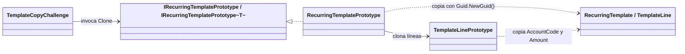

## Explicación del problema

Duplicar una plantilla contable recurrente (`RecurringTemplate`) con un nuevo `Id`, conservando el `Name` y clonando en profundidad sus `Lines` y `Tags` para evitar mutaciones cruzadas.

Copiar referencias directas o armar copias a mano acopla el código, arriesga compartir listas/objetos mutables y puede reutilizar el mismo `Id`.

## Elección del patrón

**Prototype** delega la creación de una copia a un prototipo que sabe clonarse a sí mismo (`Clone`), aislando la lógica de clonación profunda sin depender de construir desde cero ni de referencias compartidas.

Encaja mejor que **Builder** o **Factory Method** porque el punto de partida es una instancia existente (`source`) que se clona y ajusta (`Id` nuevo) en vez de crearse por tipo o por pasos desde vacío.

## Participantes de mi solución

| Participante | Responsabilidad |
| :--- | :--- |
| **`TemplateCopyChallenge` (`Copy`)** | Valida que `source` no sea nulo e invoca la clonación mediante el prototipo. |
| **`IRecurringTemplatePrototype` / `IRecurringTemplatePrototype<out T>`** | Definen el contrato `Clone()` para obtener la copia. |
| **`RecurringTemplatePrototype`** | Clona `RecurringTemplate` asignando un `Guid.NewGuid()` nuevo, conservando `Name` y clonando cada `TemplateLine`. |
| **`TemplateLinePrototype`** | Clona cada `TemplateLine` (`AccountCode`, `Amount`) y crea una nueva lista para `Tags`. |
| **`RecurringTemplate` / `TemplateLine`** | Modelos de dominio con la plantilla y sus líneas contables. |

## UML de mi solución

## Evidencia de pruebas

3/3 aprobados en este desafío; [ALL-results.trx](Evidencia/ALL-results.trx) — 66/66 en la suite completa.

Línea base conservada: [results.trx](../../reports/delivery/PatternChallenges/results.trx) — 0/66.

## Ventajas, límites y coste

- Ventaja: la clonación profunda queda encapsulada y la copia recibe un `Guid` nuevo sin reconstruir desde cero.
- Límite: cada tipo que se copie debe saber clonarse; un campo mutable nuevo exige actualizar el prototipo.
- Coste: mantener el prototipo de líneas y una lista de `Tags` nueva por copia.