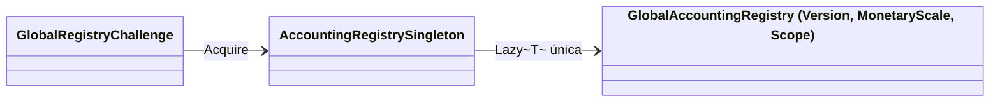

# Explicación del problema

Obtener un registro contable global (`GlobalAccountingRegistry`) con `Version = "DEMO-1"`, `MonetaryScale = 4` y `Scope = "process"` de forma consistente en todo el proceso.

Crear múltiples instancias o configuraciones distintas rompería la coherencia global de versión, escala monetaria y ámbito.

## Elección del patrón

**Singleton** garantiza una única instancia compartida y segura ante concurrencia para el registro global durante el ciclo de vida del proceso.

Encaja aquí porque el dominio exige un punto de acceso único a un registro compartido, a diferencia de **Factory Method**, **Abstract Factory**, **Builder** o **Prototype**.

## Participantes de mi solución

- **GlobalRegistryChallenge (Acquire)**  
  Devuelve la instancia única del registro contable global.

- **AccountingRegistrySingleton**  
  Encapsula la creación diferida e hilo segura (`Lazy<T>`) de `GlobalAccountingRegistry`.

- **GlobalAccountingRegistry**  
  Record inmutable con `Version`, `MonetaryScale` y `Scope`.

## UML de mi solución

## Evidencia de pruebas

3/3 aprobados en este desafío; [ALL-results.trx](Evidencia/ALL-results.trx) — 66/66 en la suite completa.

Línea base conservada: [results.trx](../../reports/delivery/PatternChallenges/results.trx) — 0/66.

## Ventajas, límites y coste

- Ventaja: una única instancia `Lazy<T>` y segura ante concurrencia mantiene versión, escala y ámbito coherentes.
- Límite: es un registro global durante todo el proceso, difícil de sustituir por configuración por entorno.
- Coste: acoplamiento al punto de acceso global y menos aislamiento entre pruebas.
