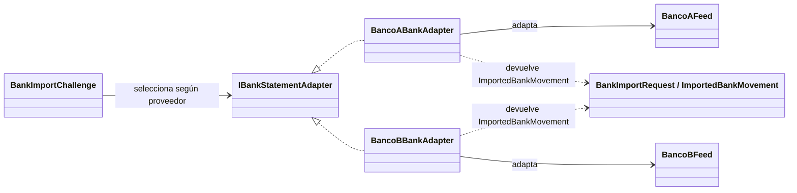

# Explicación del problema

Importar movimientos bancarios desde proveedores distintos (BancoA y BancoB) con esquemas JSON y campos diferentes hacia un modelo único `ImportedBankMovement`, conservando la precisión decimal y lanzando `FormatException` ante JSON o datos inválidos.

Leer o mapear cada proveedor directamente en el flujo principal acoplaría el código a formatos externos y dispersaría las reglas de conversión (como separar débito/crédito desde `signedAmount`).

## Elección del patrón

**Adapter** convierte la interfaz y estructura de datos de cada proveedor externo (BancoA y BancoB) en el modelo uniforme `ImportedBankMovement` que espera el sistema sin modificar las fuentes ni el llamador.

Encaja mejor que **Facade** (simplifica un subsistema) o **Decorator** (añade responsabilidades a un mismo tipo) porque traduce formatos incompatibles a un contrato común.

## Participantes de mi solución

- **BankImportChallenge (Import)**  
  Valida la solicitud, selecciona el adaptador según el proveedor y ejecuta la importación.

- **IBankStatementAdapter**  
  Define la interfaz objetivo (`Adapt`) que devuelve movimientos normalizados.

- **BancoABankAdapter / BancoBBankAdapter**  
  Adaptan los registros de cada proveedor a `ImportedBankMovement` (aplicando signo de `signedAmount` en BancoB).

- **BancoAFeed / BancoBFeed**  
  Fuentes/adaptees que leen cada esquema JSON y convierten errores de formato en `FormatException`.

- **BankImportRequest / ImportedBankMovement**  
  Modelos inmutables de petición de entrada y movimiento importado.

## UML de mi solución

## Evidencia de pruebas

3/3 aprobados en este desafío; [ALL-results.trx](Evidencia/ALL-results.trx) — 66/66 en la suite completa.

Línea base conservada: [results.trx](../../reports/delivery/PatternChallenges/results.trx) — 0/66.

## Ventajas, límites y coste

- Ventaja: los esquemas de BancoA y BancoB se traducen al modelo único sin tocar el llamador ni las fuentes.
- Límite: cada proveedor nuevo exige un adaptador y la conversión de su formato.
- Coste: las reglas de signo y precisión pueden repetirse entre adaptadores si no se comparten.
