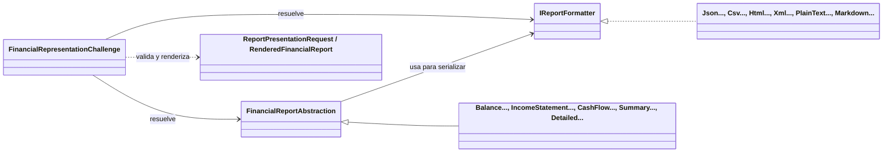

## Explicación del problema

* Renderizar reportes financieros (`ReportType`, `Format`, `Amount`) con `ContentType` adecuado, preservando el importe exacto a cuatro decimales y rechazando formatos o tipos no soportados.
* Mezclar tipos de reporte y formatos con condicionales o clases combinadas (`ReporteJson`, `ReporteCsv`, etc.) genera explosión de clases, acoplamiento y duplicación al añadir formatos o reportes.

## Elección del patrón

* **Bridge** separa la abstracción del tipo de reporte (`FinancialReportAbstraction`) de su implementación de formato (`IReportFormatter`), permitiendo combinar ambos ejes de forma independiente.
* Encaja mejor que **Adapter** (adaptar una interfaz existente) o **Strategy** por sí solo porque aquí evolucionan en paralelo dos dimensiones: qué reporte se arma y en qué formato se serializa.

## Participantes de mi solución

| Participante | Responsabilidad |
| :--- | :--- |
| **`FinancialRepresentationChallenge` (`Render`)** | Valida la entrada, resuelve el formateador y la abstracción del reporte y ejecuta el renderizado. |
| **`FinancialReportAbstraction` y refinamientos (`Balance...`, `IncomeStatement...`, `CashFlow...`, `Summary...`, `Detailed...`)** | Definen el encabezado y las secciones del reporte según el tipo solicitado. |
| **`IReportFormatter` e implementadores concretos (`Json...`, `Csv...`, `Html...`, `Xml...`, `PlainText...`, `Markdown...`)** | Definen el `ContentType`, formatean el importe con cuatro decimales y serializan el contenido. |
| **`ReportPresentationRequest` / `RenderedFinancialReport`** | Records inmutables de entrada y salida del reporte renderizado. |

## UML de mi solución

## Evidencia de pruebas

3/3 aprobados en este desafío; [ALL-results.trx](Evidencia/ALL-results.trx) — 66/66 en la suite completa.

Línea base conservada: [results.trx](../../reports/delivery/PatternChallenges/results.trx) — 0/66.

## Ventajas, límites y coste

- Ventaja: tipo de reporte y formato evolucionan por separado, evitando la explosión de clases combinadas.
- Límite: la abstracción y el formateador deben acordar el contrato de serialización.
- Coste: dos jerarquías paralelas crecen de forma independiente.