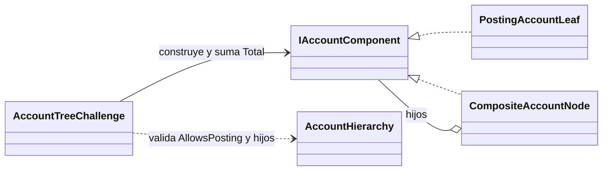

## Explicación del problema

* Calcular el saldo total de una jerarquía de cuentas (`AccountHierarchy`) sumando `OwnBalance` y los descendientes, rechazando (`ArgumentException`) cuentas con `AllowsPosting == true` que tengan hijos.
* Tratar hojas y nodos compuestos con lógica condicional dispersa complica el recorrido recursivo y mezcla la validación estructural con el cálculo del saldo.

## Elección del patrón

* **Composite** modela cuentas sin hijos y cuentas con subcuentas bajo una misma interfaz (`IAccountComponent`), permitiendo sumar balances de forma uniforme en cualquier nivel del árbol.
* Encaja mejor que **Decorator** (añadir comportamientos a un objeto) o **Visitor** (separar operaciones sobre estructuras ya construidas) porque el núcleo del reto es representar y sumar una estructura jerárquica parte-todo.

## Participantes de mi solución

| Participante | Responsabilidad |
| :--- | :--- |
| **`AccountTreeChallenge` (`Total` / `BuildComponent`)** | Valida la regla `AllowsPosting && hasChildren`, construye el árbol y obtiene el total. |
| **`IAccountComponent`** | Define `CalculateTotal()` para tratar hojas y nodos compuestos de forma uniforme. |
| **`PostingAccountLeaf`** | Representa una cuenta sin descendientes y devuelve su `OwnBalance`. |
| **`CompositeAccountNode`** | Almacena subcomponentes y suma `OwnBalance` más el total de cada hijo. |
| **`AccountHierarchy`** | Record inmutable con código, bandera de movimiento, saldo propio e hijos. |

## UML de mi solución

## Evidencia de pruebas

3/3 aprobados en este desafío; [ALL-results.trx](Evidencia/ALL-results.trx) — 66/66 en la suite completa.

Línea base conservada: [results.trx](../../reports/delivery/PatternChallenges/results.trx) — 0/66.

## Ventajas, límites y coste

- Ventaja: hojas y nodos compuestos comparten `IAccountComponent`, por lo que el saldo se suma uniformemente en cualquier nivel.
- Límite: la regla `AllowsPosting && hasChildren` se valida al construir, fuera del cálculo del total.
- Coste: el recorrido es recursivo y depende de que el árbol se mantenga consistente.