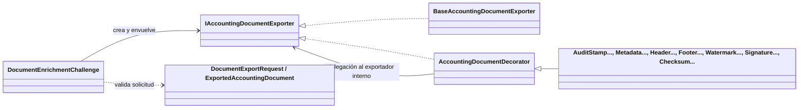

## Explicación del problema

* Exportar documentos contables (`Body`, `Features`, `Metadata`) aplicando de forma acumulativa y ordenada características como auditoría y metadatos, registrando `AppliedFeatures` y enriqueciendo el contenido y los metadatos sin mutar la entrada.
* Combinar características con condicionales o subclases fijas por combinación genera explosión de clases, acoplamiento y dificultad para encadenar extensiones en orden.

## Elección del patrón

* **Decorator** permite envolver un exportador base con decoradores independientes según la lista `Features`, añadiendo comportamiento (`Content`, `AppliedFeatures`, `Metadata`) de forma dinámica y componible.
* Encaja mejor que **Composite** (jerarquías parte-todo) o **Bridge** (separar dos ejes paralelos fijos) porque el objetivo es apilar extensiones opcionales y ordenadas sobre un mismo documento.

## Participantes de mi solución

| Participante | Responsabilidad |
| :--- | :--- |
| **`DocumentEnrichmentChallenge` (`Export` / `WrapWithFeature`)** | Valida la solicitud, crea el exportador base y envuelve secuencialmente cada característica solicitada. |
| **`IAccountingDocumentExporter`** | Define el contrato `Export()` para el componente base y los decoradores. |
| **`BaseAccountingDocumentExporter`** | Provee el documento inicial con su `Body` y una copia de `Metadata`. |
| **`AccountingDocumentDecorator` y decoradores concretos (`AuditStamp...`, `Metadata...`, `Header...`, `Footer...`, `Watermark...`, `Signature...`, `Checksum...`)** | Delegan en el exportador interno, añaden la característica a `AppliedFeatures` y aplican su enriquecimiento. |
| **`DocumentExportRequest` / `ExportedAccountingDocument`** | Records inmutables de entrada y salida del documento exportado. |

## UML de mi solución

## Evidencia de pruebas

3/3 aprobados en este desafío; [ALL-results.trx](Evidencia/ALL-results.trx) — 66/66 en la suite completa.

Línea base conservada: [results.trx](../../reports/delivery/PatternChallenges/results.trx) — 0/66.

## Ventajas, límites y coste

- Ventaja: las características se apilan en el orden solicitado sin subclases por cada combinación.
- Límite: el orden de envoltura afecta al contenido y a `AppliedFeatures`.
- Coste: muchas capas pequeñas encadenadas dificultan inspeccionar el resultado final.