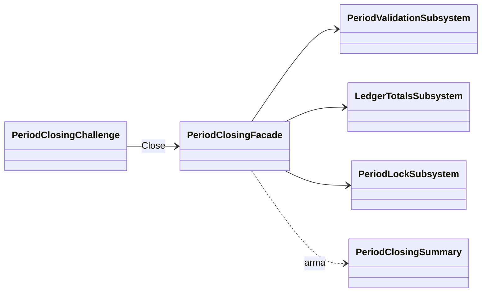

## Explicación del problema

* Ejecutar el cierre contable de un período (`ClosePeriodRequest`) validando datos, calculando totales de débito/crédito, bloqueando el cierre con `InvalidOperationException` si hay documentos pendientes o descuadre, y devolviendo `PeriodClosingSummary`.
* Coordinar validaciones, sumas y reglas de bloqueo directamente en el llamador o en un método monolítico acopla el proceso y vuelve frágiles los cambios en cada etapa.

## Elección del patrón

* **Facade** expone una operación simple (`ClosePeriod`) que coordina subsistemas internos especializados (validación, cálculo de totales y bloqueo de cierre) ocultando la secuencia y detalles de cada paso.
* Encaja mejor que **Adapter** (traducir una interfaz incompatible) o **Strategy** (intercambiar algoritmos aislados) porque el objetivo es orquestar un flujo de varios subsistemas detrás de un punto de entrada único.

## Participantes de mi solución

| Participante | Responsabilidad |
| :--- | :--- |
| **`PeriodClosingChallenge` (`Close`)** | Instancia la fachada y sus subsistemas y delega el cierre del período. |
| **`PeriodClosingFacade`** | Orquesta validación, cálculo de totales, verificación/bloqueo y armado de `PeriodClosingSummary`. |
| **`PeriodValidationSubsystem`** | Valida la solicitud, rango de fechas, documentos pendientes no negativos y saldos válidos. |
| **`LedgerTotalsSubsystem`** | Suma los débitos y créditos de las cuentas del período. |
| **`PeriodLockSubsystem`** | Verifica que no haya documentos pendientes ni descuadre, lanzando `InvalidOperationException` si el cierre no procede. |

## UML de mi solución

## Evidencia de pruebas

3/3 aprobados en este desafío; [ALL-results.trx](Evidencia/ALL-results.trx) — 66/66 en la suite completa.

Línea base conservada: [results.trx](../../reports/delivery/PatternChallenges/results.trx) — 0/66.

## Ventajas, límites y coste

- Ventaja: `ClosePeriod` oculta la secuencia de validación, totales y bloqueo detrás de un punto de entrada único.
- Límite: la fachada conoce todos los subsistemas; cambiar el flujo implica tocarla.
- Coste: los subsistemas internos quedan acoplados al orden del cierre.