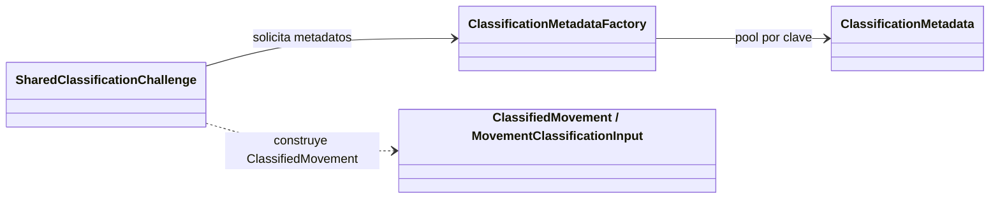

## Explicación del problema

* Clasificar colecciones de movimientos contables (`MovementClassificationInput`) compartiendo metadatos repetidos (`Code`, `Label`, `FictionalTaxScope`) entre registros, mientras `Id` y `Amount` siguen siendo propios de cada movimiento.
* Crear una nueva instancia de metadatos por cada movimiento desperdicia memoria cuando se repiten clasificaciones y dificulta verificar identidad por referencia compartida.

## Elección del patrón

* **Flyweight** separa el estado intrínseco compartible (`ClassificationMetadata`) del estado extrínseco por movimiento (`Id`, `Amount`) y centraliza su reutilización mediante una fábrica (`ClassificationMetadataFactory`).
* Encaja mejor que **Prototype** (clonar para obtener copias distintas) o **Singleton** (una única instancia global) porque aquí se necesita un pool de instancias compartidas por clave de clasificación.

## Participantes de mi solución

| Participante | Responsabilidad |
| :--- | :--- |
| **`SharedClassificationChallenge` (`Prepare`)** | Valida la entrada, solicita los metadatos compartidos a la fábrica y construye cada `ClassifiedMovement`. |
| **`ClassificationMetadataFactory`** | Mantiene el pool por clave (`Code`, `Label`, `FictionalTaxScope`) y devuelve o crea la instancia compartida. |
| **`ClassificationMetadata`** | Representa el flyweight inmutable con el estado intrínseco compartido. |
| **`ClassifiedMovement` / `MovementClassificationInput`** | Records de salida y entrada que combinan datos propios del movimiento con `ClassificationMetadata`. |

## UML de mi solución

## Evidencia de pruebas

3/3 aprobados en este desafío; [ALL-results.trx](Evidencia/ALL-results.trx) — 66/66 en la suite completa.

Línea base conservada: [results.trx](../../reports/delivery/PatternChallenges/results.trx) — 0/66.

## Ventajas, límites y coste

- Ventaja: los metadatos repetidos se comparten por clave y su identidad por referencia es verificable.
- Límite: solo se comparte el estado intrínseco; `Id` y `Amount` siguen siendo propios de cada movimiento.
- Coste: la fábrica mantiene un pool y hay que gestionar las claves.