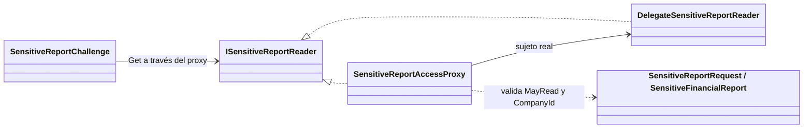

## Explicación del problema

* Consultar reportes financieros sensibles (`SensitiveReportRequest`) mediante `loadReport`, exigiendo permiso (`MayRead`), rechazando con `InvalidOperationException` si el reporte pertenece a otra `CompanyId` y validando los parámetros de entrada.
* Invocar directamente `loadReport` en el llamador mezcla reglas de autorización y aislamiento multiempresa con la obtención del dato.

## Elección del patrón

* **Proxy** (de protección/aislamiento) interpone un intermediario con la misma interfaz del sujeto real para validar `MayRead` antes de cargar y verificar `report.CompanyId == request.CompanyId` antes de devolver el reporte.
* Encaja mejor que **Facade** (orquestar varios subsistemas complejos) o **Decorator** (enriquecer salida o añadir responsabilidades acumulativas) porque controla el acceso y la devolución de un único sujeto.

## Participantes de mi solución

| Participante | Responsabilidad |
| :--- | :--- |
| **`SensitiveReportChallenge` (`Get`)** | Valida argumentos de entrada, instancia el sujeto real y el proxy, y solicita el reporte a través del proxy. |
| **`ISensitiveReportReader`** | Define la interfaz común `GetReport()` compartida por sujeto real y proxy. |
| **`DelegateSensitiveReportReader`** | Encapsula `loadReport` y obtiene el `SensitiveFinancialReport` subyacente. |
| **`SensitiveReportAccessProxy`** | Verifica `MayRead` antes de leer y valida que `report.CompanyId` coincida con `request.CompanyId` antes de retornar. |
| **`SensitiveReportRequest` / `SensitiveFinancialReport`** | Modelos de solicitud y reporte financiero sensible. |

## UML de mi solución

## Evidencia de pruebas

3/3 aprobados en este desafío; [ALL-results.trx](Evidencia/ALL-results.trx) — 66/66 en la suite completa.

Línea base conservada: [results.trx](../../reports/delivery/PatternChallenges/results.trx) — 0/66.

## Ventajas, límites y coste

- Ventaja: `MayRead` y `CompanyId` se comprueban antes de exponer el reporte sensible.
- Límite: el proxy debe conservar la misma interfaz que el sujeto real.
- Coste: una capa adicional por acceso y la interfaz compartida por dos implementaciones.