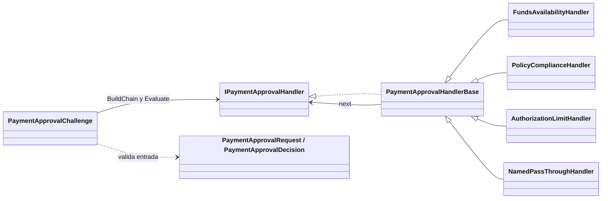

## Explicación del problema

* Evaluar una solicitud de pago (`PaymentApprovalRequest`) ejecutando controles en orden (`fondos`, `politica`, `limite` o la secuencia indicada en `Checks`), registrando `VisitedChecks` y deteniendo el flujo con `Approved = false` y `RejectedBy` ante el primer control que falle.
* Resolver cada control con un bloque condicional rígido acopla el orden de evaluación y dificulta componer o reordenar verificaciones de aprobación.

## Elección del patrón

* **Chain of Responsibility** encadena manejadores independientes donde cada eslabón registra su visita, evalúa su regla y decide si pasa al siguiente o corta la cadena con el rechazo.
* Encaja mejor que **Strategy** (elegir un único algoritmo excluyente) o **Command** (encapsular una acción para encolar o deshacer) porque aquí múltiples controles se evalúan secuencialmente hasta aprobar o rechazar.

## Participantes de mi solución

| Participante | Responsabilidad |
| :--- | :--- |
| **`PaymentApprovalChallenge` (`Evaluate` / `BuildChain`)** | Valida los datos de entrada, arma la cadena en el orden solicitado (o por defecto) y dispara la evaluación. |
| **`IPaymentApprovalHandler`** | Define `Name`, `SetNext` y `Handle` para encadenar y ejecutar cada control. |
| **`PaymentApprovalHandlerBase`** | Mantiene el siguiente eslabón, añade `Name` a `VisitedChecks`, corta en rechazo o delega al siguiente manejador. |
| **`FundsAvailabilityHandler`, `PolicyComplianceHandler`, `AuthorizationLimitHandler`, `NamedPassThroughHandler`** | Implementan la regla de cada control conservando el nombre observable del chequeo. |
| **`PaymentApprovalRequest` / `PaymentApprovalDecision`** | Records inmutables de entrada y resultado de la evaluación. |

## UML de mi solución

## Evidencia de pruebas

3/3 aprobados en este desafío; [ALL-results.trx](Evidencia/ALL-results.trx) — 66/66 en la suite completa.

Línea base conservada: [results.trx](../../reports/delivery/PatternChallenges/results.trx) — 0/66.

## Ventajas, límites y coste

- Ventaja: los controles son componibles y reordenables, y el flujo se detiene en el primer rechazo.
- Límite: el orden de la cadena determina `VisitedChecks` y el resultado.
- Coste: cada manejador conoce el siguiente y depende del nombre observable del chequeo.