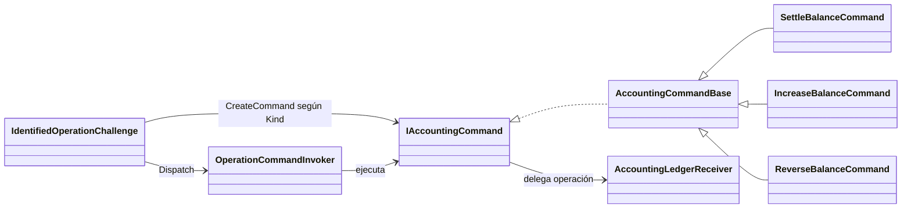

## Explicación del problema

* Ejecutar operaciones contables identificadas (`AccountingOperationRequest`) como `"apply-payment"` o `"reverse-voucher"` sobre `AccountingOperationContext`, validando datos de entrada, asegurando idempotencia por `OperationId` (`Replayed = true` si ya existe), exigiendo que el objetivo esté publicado y devolviendo `AccountingOperationReceipt`.
* Ejecutar la lógica de cada operación directamente en el punto de entrada mezcla validación, despacho por tipo, idempotencia y mutación de saldo en un solo flujo acoplado.

## Elección del patrón

* **Command** encapsula cada solicitud de operación como un objeto con `Execute()`, separando al despachador (`OperationCommandInvoker`) del receptor que aplica las reglas (`AccountingLedgerReceiver`) y permitiendo tratar la repetición de `OperationId` de forma uniforme.
* Encaja mejor que **Chain of Responsibility** (evaluar varios controles secuenciales hasta aprobar o rechazar) o **Facade** (coordinar subsistemas de un flujo compuesto) porque el núcleo aquí es despachar y ejecutar una operación concreta con estado e idempotencia.

## Participantes de mi solución

| Participante | Responsabilidad |
| :--- | :--- |
| **`IdentifiedOperationChallenge` (`Execute` / `CreateCommand`)** | Valida argumentos, crea el receptor y el invoker, y construye el comando según `Kind` (`"apply-payment"`, `"reverse-voucher"`, etc.). |
| **`IAccountingCommand` / `AccountingCommandBase`** | Define la ejecución del comando y resuelve la repetición idempotente consultando `CompletedOperations` por `OperationId`. |
| **`SettleBalanceCommand`, `IncreaseBalanceCommand`, `ReverseBalanceCommand`** | Comandos concretos que delegan la operación específica al receptor. |
| **`AccountingLedgerReceiver`** | Valida publicación del objetivo, aplica abonos, cargos o reversas (conservando vínculo de asiento cuando aplica) y calcula saldos. |
| **`OperationCommandInvoker`** | Despacha el comando invocado (`Dispatch`) sin acoplarse a detalles del receptor. |

## UML de mi solución

## Evidencia de pruebas

3/3 aprobados en este desafío; [ALL-results.trx](Evidencia/ALL-results.trx) — 66/66 en la suite completa.

Línea base conservada: [results.trx](../../reports/delivery/PatternChallenges/results.trx) — 0/66.

## Ventajas, límites y coste

- Ventaja: el despacho por `Kind` queda separado del receptor y la idempotencia por `OperationId` es uniforme.
- Límite: una operación nueva exige ampliar la creación del comando y el receptor.
- Coste: más objetos comando e invoker frente a una llamada directa.