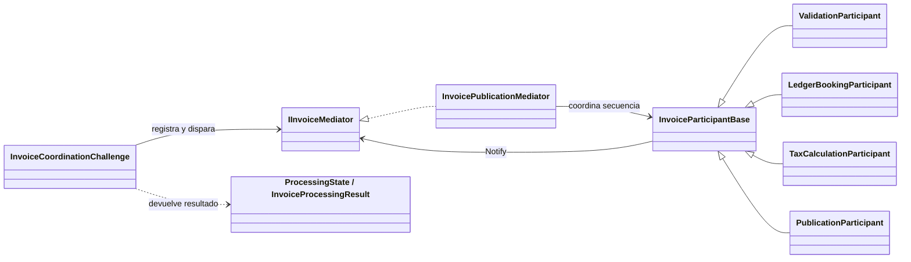

## Explicación del problema

* Coordinar el procesamiento de facturas (`InvoiceProcessingRequest`) a través de participantes (`validacion`, `contabilizacion`/`ledger`, `impuestos`/`tax`, `publicacion`) según el orden solicitado, rechazando duplicados con `ArgumentException`, deteniendo el flujo con `Published = false` si la factura no es válida y devolviendo `ParticipantsInvoked`.
* Hacer que cada paso invoque o condicione directamente al siguiente acopla los participantes y dificulta detener la secuencia o evitar contabilizar o publicar facturas inválidas.

## Elección del patrón

* **Mediator** centraliza la coordinación y las notificaciones de estado en `InvoicePublicationMediator`, desacoplando a los participantes (`ValidationParticipant`, `LedgerBookingParticipant`, `TaxCalculationParticipant`, `PublicationParticipant`) y controlando cuándo avanza o se detiene el proceso.
* Encaja mejor que **Chain of Responsibility** (enfocado en aprobar o rechazar mediante una cadena de filtros secuenciales) o **Observer** (difundir eventos a múltiples suscriptores pasivos sin orquestación centralizada) porque aquí el mediador coordina participantes ordenados con reglas de estado compartidas.

## Participantes de mi solución

| Participante | Responsabilidad |
| :--- | :--- |
| **`InvoiceCoordinationChallenge` (`Process`)** | Valida argumentos de entrada, instancia el mediador y los participantes, los registra y dispara la coordinación. |
| **`IInvoiceMediator` / `InvoicePublicationMediator`** | Valida duplicados, ejecuta la secuencia, recibe notificaciones (`Notify`) y actualiza `ProcessingState` y `Published`. |
| **`InvoiceParticipantBase`** | Base de los colegas que registra el nombre invocado y delega la ejecución concreta. |
| **`ValidationParticipant`, `LedgerBookingParticipant`, `TaxCalculationParticipant`, `PublicationParticipant`** | Colegas concretos que ejecutan validación, contabilización, cálculo de impuesto o publicación y notifican al mediador. |
| **`ProcessingState` / `InvoiceProcessingResult`** | Estado interno de la coordinación y resultado inmutable con `InvoiceId`, `Published` y `ParticipantsInvoked`. |

## UML de mi solución

## Evidencia de pruebas

3/3 aprobados en este desafío; [ALL-results.trx](Evidencia/ALL-results.trx) — 66/66 en la suite completa.

Línea base conservada: [results.trx](../../reports/delivery/PatternChallenges/results.trx) — 0/66.

## Ventajas, límites y coste

- Ventaja: los participantes quedan desacoplados y el mediador decide cuándo avanzar o detener el proceso.
- Límite: el mediador centraliza las reglas y puede ser el punto de cambio más frecuente.
- Coste: cada colega notifica al mediador en lugar de invocar directamente al siguiente.