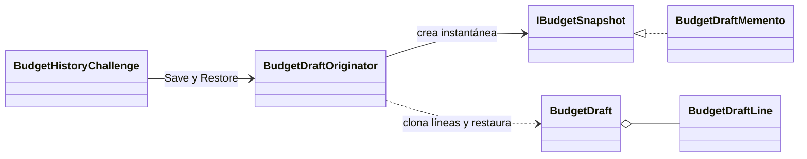

## Explicación del problema

* Guardar y restaurar el estado de un borrador de presupuesto (`BudgetDraft`, incluyendo sus `BudgetDraftLine`) mediante `IBudgetSnapshot`, bloqueando con `InvalidOperationException` si el presupuesto está aprobado y conservando la copia profunda para aislar mutaciones.
* Exponer los campos internos o compartir referencias mutables de líneas acopla el historial a la estructura interna del borrador y permite alterar instantáneas ya guardadas.

## Elección del patrón

* **Memento** captura el estado interno de `BudgetDraft` en un objeto opaco (`BudgetDraftMemento` tras `IBudgetSnapshot`) y lo restaura a través del originador (`BudgetDraftOriginator`) sin romper el encapsulamiento.
* Encaja mejor que **Prototype** (clonar objetos para instanciar variantes nuevas) o **Command** (encapsular acciones ejecutables o deshacibles) porque aquí el objetivo es guardar y restaurar un estado concreto de borrador.

## Participantes de mi solución

| Participante | Responsabilidad |
| :--- | :--- |
| **`BudgetHistoryChallenge` (`Save` / `Restore`)** | Valida argumentos, rechaza presupuestos aprobados (`Approved == true`) y coordina el originador para guardar o restaurar. |
| **`BudgetDraftOriginator`** | Crea instantáneas clonando `Lines` y restaura el estado de `BudgetDraft` desde un `BudgetDraftMemento`. |
| **`IBudgetSnapshot` / `BudgetDraftMemento`** | Contenedor opaco que guarda `Id`, `Name`, `Approved` y la copia de `Lines`. |
| **`BudgetDraft` / `BudgetDraftLine`** | Modelo de dominio del borrador de presupuesto y sus líneas de cuenta y monto. |

## UML de mi solución

## Evidencia de pruebas

3/3 aprobados en este desafío; [ALL-results.trx](Evidencia/ALL-results.trx) — 66/66 en la suite completa.

Línea base conservada: [results.trx](../../reports/delivery/PatternChallenges/results.trx) — 0/66.

## Ventajas, límites y coste

- Ventaja: el estado viaja opaco tras `IBudgetSnapshot` y la copia profunda aísla mutaciones.
- Límite: el originador conoce la estructura del borrador para clonar y restaurar.
- Coste: una instantánea por guardado y el bloqueo de borradores aprobados.