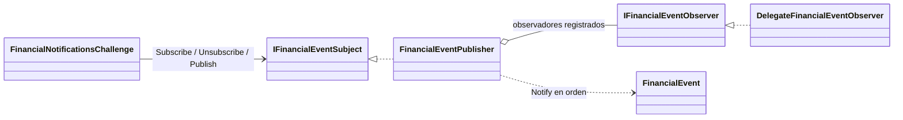

## Explicación del problema

* Gestionar suscripciones y bajas por `subscriberId` y publicar eventos financieros (`FinancialEvent`) a los observadores activos en orden, rechazando identificadores duplicados con `ArgumentException` y devolviendo los suscriptores notificados.
* Invocar directamente cada callback desde el llamador o almacenar listas sin control de duplicados acopla la publicación a los receptores y rompe la unicidad de suscripción.

## Elección del patrón

* **Observer** desacopla el publicador (`FinancialEventPublisher`) de los suscriptores (`DelegateFinancialEventObserver`), permitiéndoles suscribirse, darse de baja y recibir notificaciones de `FinancialEvent` sin conocerse entre sí.
* Encaja mejor que **Mediator** (coordinar y enrutar interacciones complejas entre colegas con reglas de flujo) o **Chain of Responsibility** (procesar o rechazar una petición en cadena) porque el objetivo es notificar eventos a múltiples suscriptores registrados.

## Participantes de mi solución

| Participante | Responsabilidad |
| :--- | :--- |
| **`FinancialNotificationsChallenge` (`Subscribe` / `Unsubscribe` / `Publish`)** | Valida entradas, delega al publicador y expone la interfaz `IFinancialNotificationsChallenge`. |
| **`IFinancialEventSubject` / `FinancialEventPublisher`** | Mantiene los observadores registrados, rechaza `subscriberId` duplicados (`ArgumentException`), elimina bajas y notifica eventos. |
| **`IFinancialEventObserver` / `DelegateFinancialEventObserver`** | Encapsula `SubscriberId` y el delegado `Action<FinancialEvent>` que recibe cada evento en `OnNext`. |
| **`FinancialEvent`** | Registro inmutable con `EventId`, `Kind` y `Amount` del evento financiero publicado. |

## UML de mi solución

## Evidencia de pruebas

3/3 aprobados en este desafío; [ALL-results.trx](Evidencia/ALL-results.trx) — 66/66 en la suite completa.

Línea base conservada: [results.trx](../../reports/delivery/PatternChallenges/results.trx) — 0/66.

## Ventajas, límites y coste

- Ventaja: publicador y suscriptores no se conocen entre sí y las altas y bajas van por `subscriberId`.
- Límite: el publicador mantiene la lista y el orden de notificación, y rechaza duplicados.
- Coste: cada evento se entrega a todos los observadores activos.