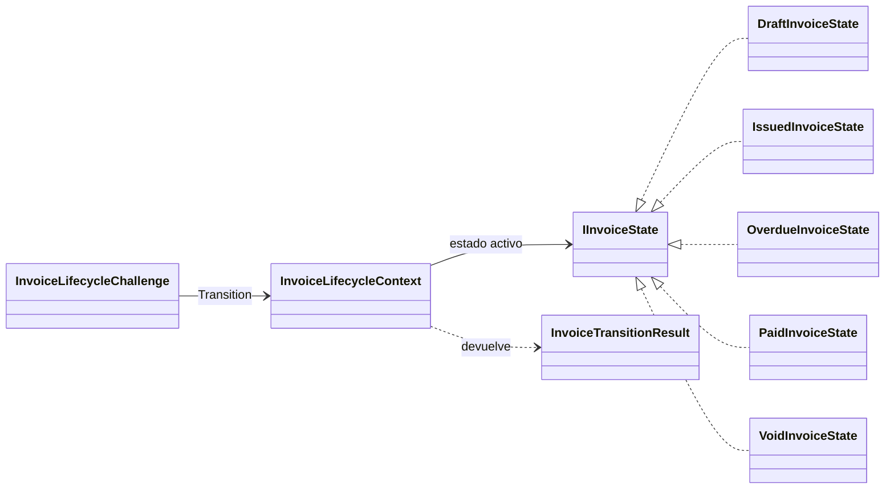

## Explicación del problema

* Gestionar transiciones del ciclo de vida de facturas (`draft`, `issued`, `overdue`, `paid`, `void`) según la acción (`issue`, `pay`, `mark-overdue`, `void`, `check`), fechas (`BusinessDate` frente a `DueDate`) y saldo pendiente, devolviendo `InvoiceTransitionResult(State, PaymentAllowed)` o lanzando `InvalidOperationException` ante transiciones inválidas.

* Resolver cada combinación de estado y acción con cadenas extensas de condicionales vuelve rígido el flujo y facilita romper reglas como permitir `pay` con saldo cero o exigir `BusinessDate > DueDate` para `mark-overdue`.

## Elección del patrón

* **State** delega el manejo de cada acción al estado actual (`DraftInvoiceState`, `IssuedInvoiceState`, `OverdueInvoiceState`, `PaidInvoiceState`, `VoidInvoiceState`) dentro de un contexto (`InvoiceLifecycleContext`), encapsulando las transiciones válidas y el cálculo de `PaymentAllowed`.

* Encaja mejor que **Strategy** (intercambiar un algoritmo independiente en lugar de cambiar el comportamiento y transiciones según el estado interno) o **Chain of Responsibility** (evaluar filtros encadenados sin modelo de estados del ciclo de vida).

## Participantes de mi solución

| Participante | Responsabilidad | 
| ----- | ----- | 
| **`InvoiceLifecycleChallenge` (`Transition`)** | Valida la entrada, crea el contexto del ciclo de vida, aplica la acción y retorna `InvoiceTransitionResult`. | 
| **`InvoiceLifecycleContext`** | Resuelve estado y acción, mantiene el estado activo y expone el resultado final. | 
| **`IInvoiceState`** | Contrato común con `Name` y `HandleAction` para cada estado de la factura. | 
| **`DraftInvoiceState`, `IssuedInvoiceState`, `OverdueInvoiceState`, `PaidInvoiceState`, `VoidInvoiceState`** | Estados concretos que aplican reglas de transición, vencimiento estricto, pago y bloqueo en estados finales. |

## UML de mi solución

## Evidencia de pruebas

3/3 aprobados en este desafío; [ALL-results.trx](Evidencia/ALL-results.trx) — 66/66 en la suite completa.

Línea base conservada: [results.trx](../../reports/delivery/PatternChallenges/results.trx) — 0/66.

## Ventajas, límites y coste

- Ventaja: las reglas de cada estado quedan encapsuladas y las transiciones inválidas se rechazan con `InvalidOperationException`.
- Límite: el contexto resuelve estado y acción; un estado nuevo debe implementar `IInvoiceState`.
- Coste: una clase por estado aunque algunas reglas sean simples.
