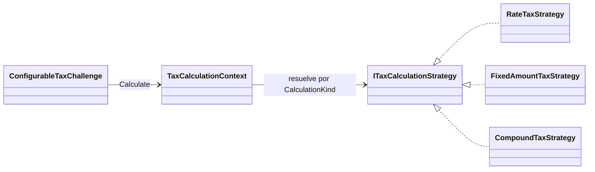

## Explicación del problema

* Calcular impuestos sobre un monto base (`BaseAmount`) seleccionando la regla vigente (`ValidFrom` a `ValidTo`) que coincida con `OperationKind`, aplicando la fórmula de cálculo correspondiente (`rate`, `fixed` o `compound`), redondeando importes y tasas a 4 decimales (`MidpointRounding.AwayFromZero`) y lanzando `InvalidOperationException` si no hay regla vigente.
* Resolver cada tipo de cálculo dentro de un único bloque condicional acopla fórmulas distintas y dificulta mantener o ampliar reglas fiscales sin tocar el flujo de selección.

## Elección del patrón

* **Strategy** encapsula cada fórmula fiscal (`RateTaxStrategy`, `FixedAmountTaxStrategy`, `CompoundTaxStrategy`) tras `ITaxCalculationStrategy` y la selecciona en `TaxCalculationContext` según `CalculationKind`.
* Encaja mejor que **State** (transicionar entre estados de un ciclo de vida con reglas propias) o **Chain of Responsibility** (encadenar filtros o aprobaciones secuenciales) porque el objetivo es intercambiar algoritmos de cálculo para una regla ya seleccionada.

## Participantes de mi solución

| Participante | Responsabilidad |
| :--- | :--- |
| **`ConfigurableTaxChallenge` (`Calculate`)** | Valida la solicitud, busca la regla vigente por operación y fecha, y ejecuta el cálculo. |
| **`TaxCalculationContext`** | Resuelve la estrategia según `CalculationKind` y delega `Compute`. |
| **`ITaxCalculationStrategy`** | Contrato común que define el cálculo del impuesto para una base y regla. |
| **`RateTaxStrategy`, `FixedAmountTaxStrategy`, `CompoundTaxStrategy`** | Estrategias concretas para cálculo porcentual, monto fijo y combinación de tasa más monto fijo con redondeo a 4 decimales. |

## UML de mi solución

## Evidencia de pruebas

3/3 aprobados en este desafío; [ALL-results.trx](Evidencia/ALL-results.trx) — 66/66 en la suite completa.

Línea base conservada: [results.trx](../../reports/delivery/PatternChallenges/results.trx) — 0/66.

## Ventajas, límites y coste

- Ventaja: las fórmulas son intercambiables tras `ITaxCalculationStrategy` y se eligen según la regla vigente.
- Límite: la estrategia se decide antes de calcular y no cambia durante la operación.
- Coste: una clase por fórmula y una resolución previa de `CalculationKind`.