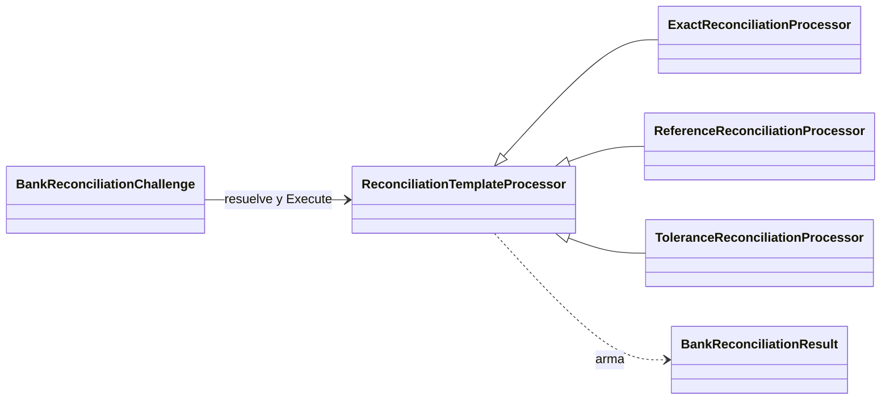

## Explicación del problema

* Conciliar movimientos bancarios (`BankStatementItem`) con movimientos contables (`ReconciliationLedgerItem`) según el modo solicitado (`exact`, `reference` o `tolerance`), respetando la tolerancia no negativa (`ArgumentOutOfRangeException` si es menor a cero), evitando reutilizar partidas contables ya asignadas y devolviendo coincidencias y no conciliados.
* Repetir el ciclo de recorrido, control de usados, cálculo de diferencia redondeada y armado del resultado en cada modo duplica lógica y facilita inconsistencias entre modos.

## Elección del patrón

* **Template Method** fija el esqueleto general de conciliación en `ReconciliationTemplateProcessor.Execute` y delega el criterio específico de emparejamiento (`FindBestMatch`) y los pasos/hooks protegidos a las subclases concretas.
* Encaja mejor que **Strategy** puro cuando se busca compartir y fijar un flujo de ejecución común con pasos extensibles, o que **State** (transiciones de estado de un ciclo de vida) porque aquí el proceso recorre colecciones de entrada para producir un resultado de conciliación.

## Participantes de mi solución

| Participante | Responsabilidad |
| :--- | :--- |
| **`BankReconciliationChallenge` (`Reconcile`)** | Valida `request`, `Mode`, colecciones y `Tolerance` (lanza `ArgumentOutOfRangeException` si es negativa), resuelve el procesador y ejecuta el flujo. |
| **`ReconciliationTemplateProcessor`** | Define el algoritmo plantilla (`Execute`), el control de `usedLedgerIds`, el redondeo a 4 decimales y los métodos protegidos (`FindBestMatch`, `CalculateDifference`, hooks). |
| **`ExactReconciliationProcessor`** | Empareja por coincidencia exacta de importe, fecha y referencia normalizada. |
| **`ReferenceReconciliationProcessor`** | Empareja por referencia coincidente y menor diferencia absoluta dentro de `Tolerance`. |
| **`ToleranceReconciliationProcessor`** | Empareja dentro de `Tolerance` y proximidad de fecha (hasta 5 días), priorizando menor diferencia de monto y días. |

## UML de mi solución

## Evidencia de pruebas

3/3 aprobados en este desafío; [ALL-results.trx](Evidencia/ALL-results.trx) — 66/66 en la suite completa.

Línea base conservada: [results.trx](../../reports/delivery/PatternChallenges/results.trx) — 0/66.

## Ventajas, límites y coste

- Ventaja: `Execute` fija el esqueleto común y `FindBestMatch` varía por modo sin duplicar el recorrido.
- Límite: un modo nuevo debe encajar en el esqueleto y en `FindBestMatch`.
- Coste: los hooks virtuales no sobrescritos y la ventana de 5 días son decisiones propias que conviene justificar.