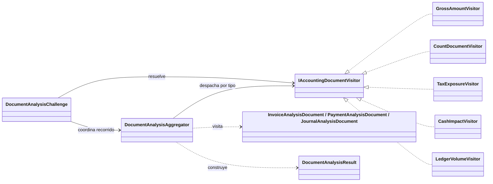

## Explicación del problema

* Analizar colecciones de documentos contables (`InvoiceAnalysisDocument`, `PaymentAnalysisDocument`, `JournalAnalysisDocument`) según la vista solicitada (`gross`, `count`, `tax`, `cash`, `ledger`), acumulando `TotalAmount`, `DocumentCount` y `ByKind` con redondeo a 4 decimales (`MidpointRounding.AwayFromZero`) y rechazando vistas desconocidas con `ArgumentException`.
* Agregar cálculos de distintas vistas dentro de los modelos de documentos o con condicionales dispersos acopla las estructuras de datos a cada reporte y dificulta incorporar nuevas vistas.

## Elección del patrón

* **Visitor** separa las operaciones de análisis por vista (`GrossAmountVisitor`, `CountDocumentVisitor`, `TaxExposureVisitor`, `CashImpactVisitor`, `LedgerVolumeVisitor`) detrás de `IAccountingDocumentVisitor`, permitiéndoles operar sobre cada tipo concreto de documento sin modificar los records de dominio.
* Encaja mejor que **Composite** (tratar composiciones jerárquicas parte-todo) o **State** (gestionar transiciones de un ciclo de vida) porque el objetivo es aplicar distintas operaciones sobre una lista de tipos de documentos ya definidos.

## Participantes de mi solución

| Participante | Responsabilidad |
| :--- | :--- |
| **`DocumentAnalysisChallenge` (`Analyze`)** | Valida `request`, `View` y `Documents`, resuelve el visitante y coordina el recorrido y la agregación. |
| **`IAccountingDocumentVisitor`** | Contrato con operaciones de visita para facturas, pagos y asientos contables. |
| **`DocumentAnalysisAggregator`** | Recorre los documentos, despacha hacia el visitante, acumula `TotalAmount`, `DocumentCount` y `ByKind`, y construye `DocumentAnalysisResult`. |
| **Visitantes concretos (`GrossAmountVisitor`, `CountDocumentVisitor`, `TaxExposureVisitor`, `CashImpactVisitor`, `LedgerVolumeVisitor`)** | Calculan el aporte de cada tipo de documento según la vista elegida. |

## UML de mi solución

## Evidencia de pruebas

3/3 aprobados en este desafío; [ALL-results.trx](Evidencia/ALL-results.trx) — 66/66 en la suite completa.

Línea base conservada: [results.trx](../../reports/delivery/PatternChallenges/results.trx) — 0/66.

## Ventajas, límites y coste

- Ventaja: añadir una vista nueva no obliga a modificar los records de dominio.
- Límite: el agregador conoce los tres tipos concretos; un cuarto tipo exige tocar interfaz, agregador y visitantes.
- Coste: cada vista implica un visitante concreto adicional.